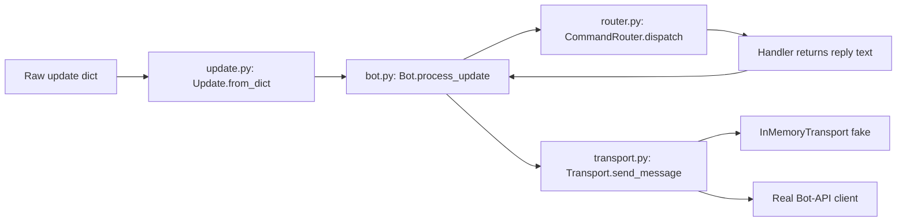

<p align="center">
  
</p>

<h1 align="center">Telegram Bot Template</h1>

<p align="center">
  <strong>A transport-agnostic Telegram bot framework — update parsing, command routing, and handlers in Python.</strong><br>
  Parse updates into typed objects, route <code>/commands</code> to handlers, and test the whole thing offline with a fake transport.
</p>

<p align="center">
  <em>Built and maintained by <a href="https://viprasol.com">Viprasol Tech</a> — Fintech Experts. Full-Stack Builders.</em>
</p>

<p align="center">
  <a href="https://github.com/Viprasol-Tech/telegram-bot-template/actions/workflows/ci.yml"></a>
  <a href="LICENSE"></a>
  
  <a href="https://t.me/viprasol_help"></a>
  <a href="https://github.com/Viprasol-Tech/telegram-bot-template/stargazers"></a>
</p>

---

> ## Offline by design — pluggable transport
> This template depends only on a tiny `Transport` protocol (`send_message`), never on the network directly. A deterministic `InMemoryTransport` fake ships in the box, so the demo and the entire test suite run with **no bot token, no network, and no `python-telegram-bot` dependency**. To go live, drop in a real transport that wraps the Bot API `sendMessage` method — the parsing, routing, and handler logic stays exactly the same.

---

## Features

- **Typed update parsing** — turn a raw Telegram update dict into an immutable `Update` (`chat_id`, `user_id`, `text`, `command`, `args`).
- **Command routing** — `CommandRouter` registers handlers for `/start`, `/help`, and any custom command, with a single default handler for everything else.
- **`/cmd@BotName` aware** — group-chat command addressing is parsed and honoured.
- **Pluggable transport** — one `Transport` protocol; `InMemoryTransport` fake for tests, real HTTP client for production.
- **Bot glue** — `Bot.process_update(dict)` runs the full parse to route to send pipeline.
- **CLI** — `telegram-bot-template demo` feeds synthetic updates and prints each reply, fully offline.
- **Modern tooling** — ruff, mypy (strict), pytest, GitHub Actions CI.

## Quickstart

```bash
git clone https://github.com/Viprasol-Tech/telegram-bot-template.git
cd telegram-bot-template
python -m pip install -e ".[dev]"

# Feed a few synthetic updates through the bot, offline:
telegram-bot-template demo
```

## Build your own bot

```python
from telegram_bot_template.bot import Bot
from telegram_bot_template.router import CommandRouter
from telegram_bot_template.transport import InMemoryTransport
from telegram_bot_template.update import Update

router = CommandRouter()


@router.command("ping")
def ping(update: Update) -> str:
    return "pong"


transport = InMemoryTransport()
bot = Bot(router, transport)

bot.process_update(
    {
        "update_id": 1,
        "message": {"chat": {"id": 42}, "from": {"id": 7}, "text": "/ping"},
    }
)

assert transport.last is not None
assert transport.last.text == "pong"  # recorded, not sent over the network
```

## Architecture



## Roadmap

- [x] Typed update parsing with `/cmd@BotName` support
- [x] Command router with default handler + decorator registration
- [x] Transport protocol + in-memory fake
- [ ] Inline keyboards and callback-query routing
- [ ] Long-polling and webhook live transports
- [ ] Middleware hooks (logging, rate-limiting, auth)

## Contributing

PRs welcome — see [CONTRIBUTING.md](CONTRIBUTING.md) and our [Code of Conduct](CODE_OF_CONDUCT.md).

## 📬 Contact — Viprasol Tech Private Limited

- 🌐 Website: [viprasol.com](https://viprasol.com)
- ✉️ Email: [support@viprasol.com](mailto:support@viprasol.com)
- 💬 Telegram: [t.me/viprasol_help](https://t.me/viprasol_help) · 📱 WhatsApp: +91 96336 52112
- 🐙 GitHub: [@Viprasol-Tech](https://github.com/Viprasol-Tech) · 💼 [LinkedIn](https://www.linkedin.com/in/viprasol/) · 𝕏 [@viprasol](https://twitter.com/viprasol)

> *Viprasol Tech — fintech software, algorithmic trading systems, MT4/MT5 bots, AI voice agents, and B2B SaaS. Need a custom build? [Get in touch](mailto:support@viprasol.com).*

## License

[MIT](LICENSE) (c) 2025 Viprasol Tech Private Limited
